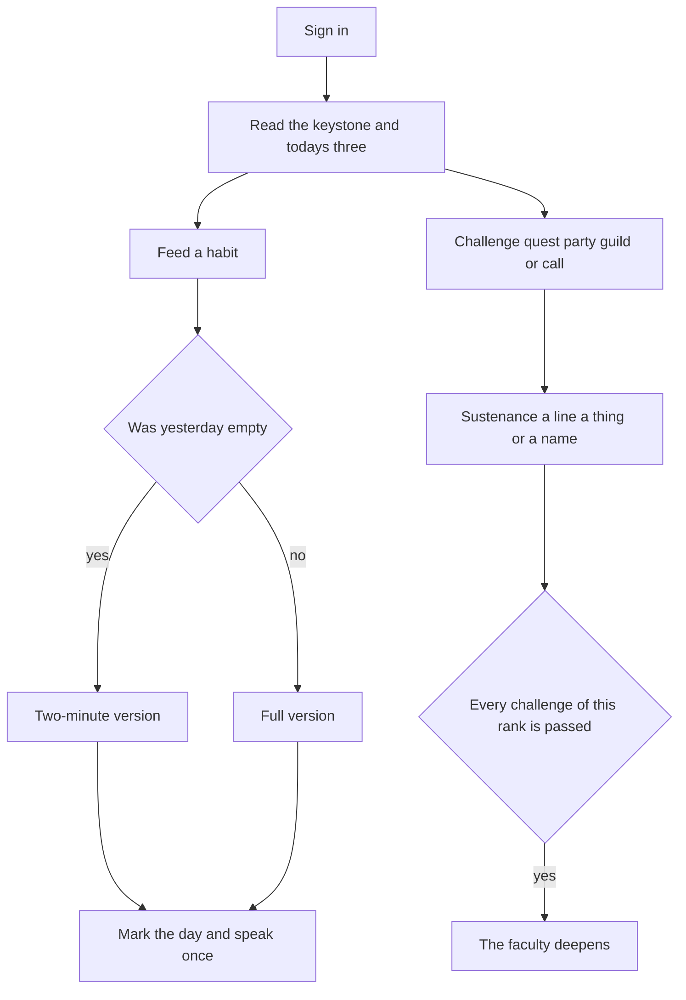

# The Binding

A status window for real life. Something from outside the sky is fastened to you. Your habits feed it. Your quests and skill ranks let it stay. It keeps the record, the names, and the next small act, which is how it keeps you.

You need it because a task list only says what is unfinished. The binding says what chapter you are in, what you are becoming, and that today is still unfed. It needs you because a quiet host thins it. The record stays. The hunger returns at dawn.

Other bound people can be seen, gathered into a party of four, housed in a guild, or called into a duel. The number on the board is sustenance. The screen speaks of feeding, faculties, and what the binding grew. Sustenance is kept. It is not spent, and a quiet day does not take it away.

## Why it is worth opening

- The window is a reading of you: condition, arc, the habit you are voting for, the skill you are deepening, the one quest that matters.
- A show-up is small on purpose. Identity, a cue, and a two-minute version are enough to count.
- The long rewards arrive later: a higher rank, a name the binding gives you, a thing it grew.
- Other people make the feeding visible without making your notes public.
- When the day is fed, the window tells you to leave and do the act. The habit happens in your life. The app is the mark after it, and the reason to come back tomorrow.

The shape comes from system novels and from habit books. A novel system gives you a window, quests, ranks, names, and other people. Atomic Habits and Tiny Habits say the quest should be a repeated vote for an identity, started in two minutes, anchored to a cue, and rewarded immediately. The binding uses the novel's voice and the books' loop. Meaning, mastery, ownership, and company do the pulling. A missed day stays a gap on the strip. It does not wipe the life of the binding, and it does not decay sustenance.

## The creature

The interface is the creature. There is no mascot and no coach.

It calls itself "this one." It calls you "you." Sentences are short, cold, and certain. It does not cheer, joke, or explain itself.

- A feeding: "You fed the binding. This one continues. You continue."
- A deeper skill: "A faculty deepened. This one can remain."
- A quiet day: "The binding thinned. This one is still attached. The smallest act will feed it."
- A return: "You came back. The binding thickens."
- After the day is fed: "Leave. Do the act. This one will hunger again at dawn."

Your condition is yours to write. The binding has its own body, read from your show-ups:

| State | When | What you see |
| --- | --- | --- |
| Fed | You have shown up today | A bright membrane, a slow pulse |
| Thin | Yesterday is empty and today is still unfed | A dim edge, and the two-minute version as the prompt |
| Faint | Two or more days have no mark | Lower contrast, a slower pulse, shorter lines |

Fed, Thin, and Faint stay on your private window. The public card and the registers do not show them.

The panel is one membrane on a near-black void. The edge is a hairline of cold green-white, slightly uneven, as if grown. Its sentences are serif. The readings are a narrow monospace. Buttons are acts: Feed, Deepen, Call, Gather. The day count reads "Day 40 of the binding." Empty screens say the binding is waiting.

## How a day goes

1. At your cue time, if you allowed it and today is still unfed, one signal arrives: "The binding is waiting. The smallest act will feed it." A fed day sends nothing. A second signal the same day is not sent.
2. You open the window. The keystone habit is above the fold, with its cue, its two-minute version, and how many challenges remain before that faculty deepens.
3. If yesterday was missed, today leads with the two-minute version.
4. You do the act in the world. You come back and feed. The binding writes the identity line, adds a mark, and adds sustenance once.
5. The membrane settles and tells you to leave.
6. At dawn the day is unfinished again.

Three feedings a day can pay. They are drawn from the habits scheduled today, keystone first. Empty slots fall back to an open quest step, an open challenge, or a line for the day. Extra habits still mark the strip and the binding still speaks. They do not pay a fourth time.

Lifetime feedings only climb. The last seven days stay visible, gap included.

## The fastening

Registration is the fastening. The screen says: "Something from outside the sky is looking for a host."

The first quest, "This One Attaches," completes itself from three acts: name a faculty, add a challenge, and save a habit with an identity, a cue, a cue time, and a two-minute version. Clearing it grants the name The Bound, the grown thing First Feeding, and a little sustenance. The window then says: "This one is attached. Feed it." It asks once if it may call you at the cue.

## What lives on the status

The status is private.

- Binding state, then your name, worn title, condition, and arc
- Sustenance and the day of the binding
- The keystone: identity, cue time, seven marks, lifetime feedings
- Faculties as `Novice — Coding`, with the challenges still required
- The main quest and how many steps are done
- Today's three feedings
- The fastening, while it is still open
- Recent names, the grown thing worn on your card, and the latest lines

## Habits, quests, and faculties

A habit is the practice. It saves only with an identity ("I am someone who sits down to write"), a cue, a cue time, and a two-minute version. The full version sits beside it. One habit is the keystone. You retire a habit when you no longer want that vote. A habit does not finish when a bar fills.

A milestone quest is the goal. It has steps. One of them is the main quest on the status. It may name the habit that feeds it. Sustenance arrives when the last step is done.

A faculty is a skill you already have. It is born at Novice. You write the challenges for the rank you are on, because the binding does not know what novice coding means in your life. When every required challenge of that rank is passed, the faculty becomes the next rank: Novice, Apprentice, Adept, Expert, Master. Master has no next rank. Setting a rank by hand is written in the log and grows nothing.

Passing a challenge asks for a short private note. The binding answers: "This one keeps the note. You keep the faculty."

An achievement is an outcome you name and claim once. A few unlock on their own. Hidden ones show as `????` and a hint until the threshold is real.

## Sustenance

Each cause pays once.

| Cause | Sustenance |
| --- | --- |
| One of today's three feedings | 3, plus 5 when all three are done |
| A challenge passed | 5 |
| A faculty risen | 25 |
| A personal quest, a party quest, or a guild quest you stepped, finished | 15 |
| An achievement claimed, or a system or hidden name opened | 10 |
| The fastening finished | 10 |
| A host you brought finishes the fastening and takes the seat | 10 to you and 10 to them |
| A call you won alone | 10 |
| A call you both cleared | 5 each |

## What it grows

These are worn or kept. They are not bought.

- First Feeding — the fastening
- A Pulse — all three feedings in a day; these stack
- A Deepened Faculty — a rank risen, named for the new rank
- A Shared Tether — the first party quest cleared
- A House Sigil — the first guild quest cleared, given to every member of that house then
- An Answered Call — a call won alone; these stack
- One wearable thing for each hidden name

One grown thing can be worn on the public card.

## Names it gives

You choose which name is worn. The binding gives these when the pattern is true.

- The Bound — the fastening is complete
- The One Who Advanced — the first faculty above Novice
- The One Who Returned — a feeding on the day after a thin day
- The One Who Called — the first call won alone
- The One Who Gathered — a host you brought takes a seat beside you
- The One Who Raised a House — a second host sits in a guild you created
- The One Who Continued — a quest finished after you had set one down
- The Binding Holds — day 30

Hidden names start masked.

- "This one is counting the mornings." — 7 feedings
- "A thin day can still be fed." — the first return
- "Time is also flesh." — day 7
- "A faculty is waiting." — the first faculty above Novice
- "Another binding answered." — a call against you is accepted
- "The call went further than you." — a host you brought fastens someone of their own
- "The gathering was fed." — a party quest is finished
- "A house is a longer hunger." — your guild is fed on seven different days
- "What you set down can be taken up." — a quest finished after you had set one down

## Other hosts

A host alone is complete. An empty seat is an invitation. After the fastening, the binding says: "Call another host. A binding among hosts lasts longer." The person who was invited hears the same line after their own fastening.

**A party** is the near circle. Four hosts, one shared quest, and a mark for who fed the keystone today. You can see the mark. You cannot see the note. Clearing the quest feeds every member and grows A Shared Tether the first time.

You gather by a link. A new host who opens it fastens an account to you and, after "This One Attaches," is offered the seat. An existing host can accept the same code. A full party still binds them and says they can gather their own. An unused link pays nothing. Creating an empty party does not grant The One Who Gathered. That name arrives when someone you brought sits. You hear: "Another host fastened because of you." They hear: "You were called. Call another."

**A guild** is the house around the party. You may keep one party and one guild. A guild has a name, a one-line creed, a keeper, and up to 30 hosts. The binding says: "A gathering is near. A house is wider."

The register of houses is ordered by how many keystone feedings the members gave this week, so a quiet crowd does not outrank a house that ate. Inside the house, a fed day leaves a mark and a quiet day is left blank. The line is "14 hosts fed the house today." It does not name the quiet.

One guild quest is active at a time. Members who checked a step receive the quest's sustenance. Everyone then in the house receives A House Sigil the first time. An empty guild grants nothing. The One Who Raised a House arrives with the second host. Personal sustenance stays with the person who earned it if they leave. If the keeper leaves, the oldest remaining member keeps the house.

**A call** is a duel made from a public card: terms, a deadline, and an acceptance. One clearer at the deadline is answered. Both cleared feeds both and grows nothing to wear. Neither cleared closes, and sustenance stays as it was. A pair may have one pending or active call.

**A public card** shows name, day of the binding, worn title, sustenance, faculties, earned names, the grown thing worn, the party name, and the house name. Condition, cues, quest text, notes, the log, binding state, and the rest of what it grew stay inside the host.

**The register of the bound** orders accounts by sustenance.

## How we will build it

Two processes, one SQLite file.

- `web` is a Next.js app. It renders the membrane and speaks to the API through an httpOnly session cookie.
- `api/Status.Api` is an ASP.NET Core API on .NET 10. Identity, the rules, the voice templates, sustenance, and the SQLite database live here. The browser does not choose which user it is. The token does.

Build in this order, so the private window works before the social pieces:

1. Accounts, the status, habits, milestone quests, faculties, challenges, and the log.
2. Dailies, the return after a miss, hidden names, given names, the day count, grown things, the fastening, and the single cue-time signal.
3. Public cards, fastening links, parties, guilds, and calls.

The first version is done when two people can fasten, feed, watch the membrane go Fed and Thin, deepen `Novice — Coding` into `Apprentice — Coding`, bring each other in by a link, sit in a party and a house, resolve a call, and see the registers move, while private notes stay private.
